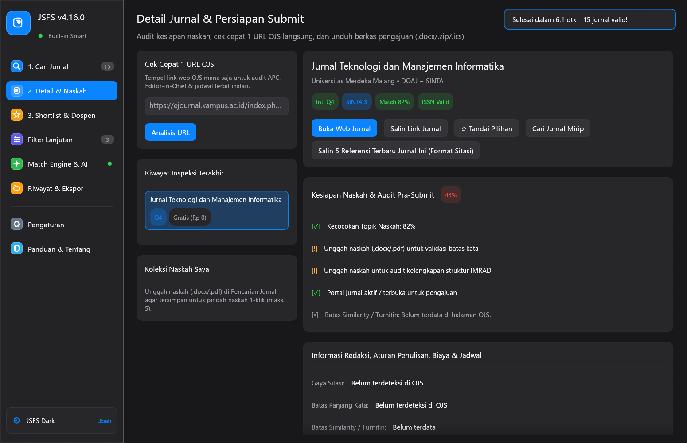

<div align="center">


# JSFS - Journal Scraper For Students

**Temukan jurnal SINTA, Garuda, dan internasional Q1-Q4 secara serentak, validasi biaya publikasi (APC) asli, estimasikan waktu terbit, dan cocokkan dengan draf naskah Anda dalam satu aplikasi desktop Pure Rust.**

[](https://github.com/BakwanJagungg/JSFS-Journal-Scraper-For-Students-/releases/tag/v4.16.0)
[](https://github.com/BakwanJagungg/JSFS-Journal-Scraper-For-Students-/releases/tag/v4.16.0)
[-f97316?style=flat-square&logo=rust&logoColor=white)](docs/ARCHITECTURE.md)
[](LICENSE)

<br />

[](https://github.com/BakwanJagungg/JSFS-Journal-Scraper-For-Students-/releases/download/v4.16.0/JSFS-windows-x64-setup.exe)
[-ea580c?style=for-the-badge&logo=linux&logoColor=white)](https://github.com/BakwanJagungg/JSFS-Journal-Scraper-For-Students-/releases/download/v4.16.0/JSFS-linux-x64.tar.gz)
[](https://github.com/BakwanJagungg/JSFS-Journal-Scraper-For-Students-/releases/download/v4.16.0/JSFS-macos-arm64-preview.tar.gz)

<p>
  <a href="https://github.com/BakwanJagungg/JSFS-Journal-Scraper-For-Students-/releases/download/v4.16.0/SHA256SUMS.txt">SHA256SUMS.txt</a> •
  <a href="https://github.com/BakwanJagungg/JSFS-Journal-Scraper-For-Students-/releases">Semua Rilis</a> •
  <a href="docs/CHANGELOG.md">Catatan Rilis (Changelog)</a> •
  <a href="docs/ARCHITECTURE.md">Arsitektur Teknis</a>
</p>

</div>

## Tampilan Antarmuka Nyata

<table>
  <tr>
    <td align="center" width="50%">
      <strong>1. Cari Jurnal & Filter Biaya APC Real-Time</strong><br /><br />
      
    </td>
    <td align="center" width="50%">
      <strong>2. Detail Jurnal, Estimasi Terbit & Kesiapan Naskah</strong><br /><br />
      
    </td>
  </tr>
</table>

## Unduhan Lintas Platform (v4.16.0)

| Platform & Paket | Arsitektur | Keterangan & Lokasi Hasil |
| :--- | :---: | :--- |
| **[Windows Installer (`JSFS-windows-x64-setup.exe`)](https://github.com/BakwanJagungg/JSFS-Journal-Scraper-For-Students-/releases/download/v4.16.0/JSFS-windows-x64-setup.exe)** | Windows x64 | **Direkomendasikan**: pasang dengan ikon Desktop & Start Menu tanpa hak Admin. Output: `Documents\JSFS Output` |
| **[Windows Portable (`JSFS-windows-x64-portable.zip`)](https://github.com/BakwanJagungg/JSFS-Journal-Scraper-For-Students-/releases/download/v4.16.0/JSFS-windows-x64-portable.zip)** | Windows x64 | Ekstrak dan jalankan langsung tanpa instalasi. Output: folder `output\` di samping `jsfs.exe` |
| **[Windows 32-bit Portable (`JSFS-windows-x86-portable.zip`)](https://github.com/BakwanJagungg/JSFS-Journal-Scraper-For-Students-/releases/download/v4.16.0/JSFS-windows-x86-portable.zip)** | Windows x86 | Khusus perangkat laptop atau Windows 10/11 32-bit. Output: folder `output\` di samping `jsfs.exe` |
| **[Windows Single Binary (`jsfs.exe`)](https://github.com/BakwanJagungg/JSFS-Journal-Scraper-For-Students-/releases/download/v4.16.0/jsfs.exe)** | Windows x64 | Satu file biner mandiri siap pakai tanpa kompresi zip |
| **[Linux Desktop (`JSFS-linux-x64.tar.gz`)](https://github.com/BakwanJagungg/JSFS-Journal-Scraper-For-Students-/releases/download/v4.16.0/JSFS-linux-x64.tar.gz)** | Linux x86_64 | Ekstrak arsip lalu jalankan `./jsfs` (mendukung X11 dan Wayland) |
| **[macOS Preview (`JSFS-macos-arm64-preview.tar.gz`)](https://github.com/BakwanJagungg/JSFS-Journal-Scraper-For-Students-/releases/download/v4.16.0/JSFS-macos-arm64-preview.tar.gz)** | Apple Silicon (arm64) | Build pratinjau native Apple Silicon (ekstrak lalu jalankan `./jsfs`) |
| **[Verifikasi Integritas (`SHA256SUMS.txt`)](https://github.com/BakwanJagungg/JSFS-Journal-Scraper-For-Students-/releases/download/v4.16.0/SHA256SUMS.txt)** | Semua Platform | Daftar hash SHA-256 resmi untuk memverifikasi seluruh paket unduhan |

**Perintah Cepat PowerShell (Unduh & Pasang JSFS v4.16.0 di Windows):**

```powershell
$p="$env:TEMP\JSFS-windows-x64-setup.exe"; Invoke-WebRequest "https://github.com/BakwanJagungg/JSFS-Journal-Scraper-For-Students-/releases/download/v4.16.0/JSFS-windows-x64-setup.exe" -OutFile $p; Start-Process $p
```

## Keunggulan Utama

- **Arsitektur Pure Rust Ultra Ringan**: Dirancang tanpa WebView2, Electron, maupun Node.js. Konsumsi RAM stabil di kisaran `85-118 MB` saat aktif dan `0%` CPU saat diam, dengan batas konkurensi otomatis untuk laptop 4-core ke bawah.
- **Pencarian Serentak Nasional & Internasional**: Menggabungkan data dari **SINTA (1-6)**, **Garuda**, **OpenAlex**, **DOAJ**, dan **Crossref** (untuk jurnal internasional Q1-Q4) lengkap dengan pelacakan latensi host agar server kampus lambat tidak menahan antrean.
- **Akurasi APC Anti-Jebakan**: Memisahkan biaya publikasi asli (termasuk total pajak editorial) dari biaya submit Rp 0, mengabaikan jebakan biaya cetak eksemplar (*print fee decoy*), denda penarikan naskah, dan klausa gratis historis, dengan konversi seragam **IDR / USD**.
- **Turnaround Time & Jadwal Terbit Estimator**: Mengekstrak riwayat tanggal artikel (*Received*, *Accepted*, *Published*) dari OJS dan Crossref untuk menampilkan estimasi durasi tunggu publikasi yang ramah mahasiswa (misal: `Sekitar 2,5 Bulan (75 Hari)`).
- **Asisten Naskah Offline (`.docx` / `.pdf`)**: Menghitung *Match Score* BM25 dwibahasa ID-EN, mengekstrak chip topik, mendeteksi gaya sitasi dominan (**APA vs IEEE**), mengecek kesesuaian batas kata (*Pre-Flight Fit Check*), serta menyalin 5 referensi terbaru jurnal target dalam 1 klik.
- **In-App Self-Updater Terverifikasi SHA-256**: Mendukung pembaruan langsung dari dalam aplikasi dengan validasi hash SHA-256 terhadap `SHA256SUMS.txt` sebelum mengganti biner aktif.
- **Paket Kurasi Dospen (`.jsfs-list` & HTML)**: Tandai kandidat favorit dengan bintang, bandingkan berdampingan di tab **3. Shortlist & Dospen**, ekspor paket portabel `.jsfs-list` beserta ringkasan HTML responsif siap kirim ke dosen pembimbing, atau buat bundel **Cover Letter & Surat Keaslian (`.docx` / `.zip`)**.

## Panduan Singkat Keamanan OS (SmartScreen & Gatekeeper)

> **Windows SmartScreen**: Karena JSFS adalah proyek open-source gratis tanpa sertifikat *EV Code Signing* berbayar, Windows Defender SmartScreen dapat menampilkan peringatan saat pertama kali dijalankan. Klik **More info** (*Info lebih lanjut*) lalu pilih **Run anyway** (*Tetap jalankan*).

> **macOS Gatekeeper (Preview Build)**: Untuk build pratinjau Apple Silicon yang belum melalui proses notarisasi Apple, jalankan perintah berikut di Terminal pada folder hasil ekstrak sebelum membuka `./jsfs`:
> ```bash
> xattr -d com.apple.quarantine ./jsfs && chmod +x ./jsfs && ./jsfs
> ```

## Mulai Cepat

1. **Unduh** paket sesuai sistem operasi Anda dari tabel di atas.
2. **Jalankan** aplikasi tanpa perlu memasang runtime tambahan.
3. **Ketik topik penelitian** atau **Unggah Naskah** (`.docx` / `.pdf`), lalu tekan **Mulai Cari Jurnal**.

Antarmuka tersedia dalam **Bahasa Indonesia** dan **English** dengan mode gelap dan terang pada menu **Pengaturan**.

## Kompilasi dari Kode Sumber

Membutuhkan [Rust toolchain](https://rustup.rs/) (versi stabil terbaru). Pada Linux Debian/Ubuntu, pasang paket desktop minimal terlebih dahulu:

```bash
sudo apt-get install -y libgtk-3-dev libxcb-render0-dev libxcb-shape0-dev libxcb-xfixes0-dev libxkbcommon-dev libssl-dev pkg-config
```

Lalu bangun dari sumber:

```bash
git clone https://github.com/BakwanJagungg/JSFS-Journal-Scraper-For-Students-.git
cd JSFS-Journal-Scraper-For-Students-
cargo build --release --locked
```

Jalankan `cargo test --locked` untuk memverifikasi seluruh unit test internal. Informasi arsitektur tersedia di [docs/ARCHITECTURE.md](docs/ARCHITECTURE.md) dan riwayat perubahan di [docs/CHANGELOG.md](docs/CHANGELOG.md).

## Lisensi

Dirilis di bawah lisensi [MIT](LICENSE) oleh BakwanJagungg.
