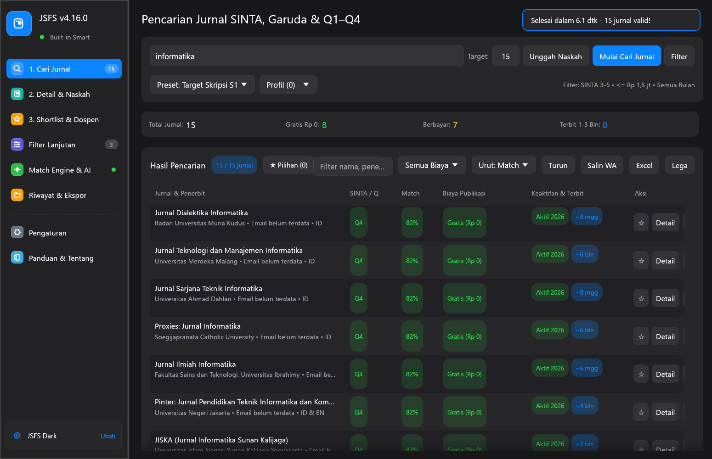

<div align="center">


# JSFS & JSFS+ Workstation

**Temukan jurnal SINTA, Garuda, dan internasional Q1 hingga Q4 secara serentak, validasi biaya publikasi (APC) asli, estimasikan waktu terbit, dan cocokkan dengan draf naskah Anda dalam satu aplikasi desktop Pure Rust.**

[](https://github.com/BakwanJagungg/JSFS-Journal-Scraper-For-Students-/releases/tag/v4.16.2)
[](https://github.com/BakwanJagungg/JSFS-Journal-Scraper-For-Students-/releases/tag/plus-v5.0.0)
[](https://github.com/BakwanJagungg/JSFS-Journal-Scraper-For-Students-/releases)
[-f97316?style=flat-square&logo=rust&logoColor=white)](docs/ARCHITECTURE.md)
[](LICENSE)

<br />

<a href="https://github.com/BakwanJagungg/JSFS-Journal-Scraper-For-Students-/releases/tag/v4.16.2">
  
</a>
<a href="https://github.com/BakwanJagungg/JSFS-Journal-Scraper-For-Students-/releases/tag/plus-v5.0.0">
  
</a>

<p>
  <a href="https://github.com/BakwanJagungg/JSFS-Journal-Scraper-For-Students-/releases">Semua Rilis</a> •
  <a href="docs/CHANGELOG.md">Changelog Standard</a> •
  <a href="docs/CHANGELOG-PLUS.md">Changelog JSFS+</a> •
  <a href="docs/ARCHITECTURE.md">Arsitektur Teknis</a>
</p>

</div>

## Tampilan Antarmuka Nyata

<table>
  <tr>
    <td align="center" width="50%">
      <strong>1. Cari Jurnal & Filter Biaya APC Real-Time</strong><br /><br />
      
    </td>
    <td align="center" width="50%">
      <strong>2. Detail Jurnal, Estimasi Terbit & Kesiapan Naskah</strong><br /><br />
      
    </td>
  </tr>
</table>

## Pilih Edisi yang Sesuai Perangkat Anda

<table>
  <tr>
    <th align="left" width="50%">JSFS Standard (`v4.16.2`)</th>
    <th align="left" width="50%">JSFS+ Workstation (`plus-v5.0.0`)</th>
  </tr>
  <tr>
    <td valign="top">
      Dirancang ringan untuk semua laptop mahasiswa (Windows 64/32-bit, Linux, dan macOS Apple Silicon / Intel) dengan penggunaan RAM hemat serta UI adaptif hingga layar skala tinggi.
      <ul>
        <li>Batas pencarian hingga <strong>1.000 jurnal/sesi</strong> &amp; cache SQLite 16 MB</li>
        <li>Buffer halaman 4 MB, stream 5 MB &amp; ekstraksi biaya dari PDF OJS (&lt; 3 MB)</li>
        <li>TLS ketat dengan fallback otomatis domain kampus &amp; catatan sertifikat</li>
        <li>Deteksi sitasi <strong>IEEE, APA, Vancouver, dan Chicago/Turabian</strong></li>
        <li>Dukungan self-updater otomatis lintas Windows, Linux &amp; macOS</li>
      </ul>
    </td>
    <td valign="top">
      Dirancang khusus untuk workstation berspesifikasi tinggi (RAM 16 hingga 32 GB, CPU multi-core, dan GPU opsional) serta dapat terpasang berdampingan dengan JSFS Standard.
      <ul>
        <li>Skala hingga <strong>5.000 jurnal/sesi</strong>, cache SQLite ~128 MB &amp; hingga 64 worker paralel</li>
        <li><strong>Headless Browser Sidecar</strong> (Edge/Chrome) untuk portal Cloudflare &amp; SPA JS</li>
        <li><strong>Jembatan OCR PDF Scan</strong> (Tesseract CLI &amp; Windows Native WinRT OCR)</li>
        <li><strong>Hybrid Semantic Reranker</strong> (vektor 256-D + Ollama Embeddings GPU opsional)</li>
        <li>Indikator <strong>Citation Velocity</strong> berbasis metrik sitasi OpenAlex</li>
      </ul>
    </td>
  </tr>
</table>

## Unduhan Resmi Lintas Platform

### Edisi 1: JSFS Standard (`v4.16.2`)

| Platform & Paket | Arsitektur | Keterangan & Lokasi Hasil |
| :--- | :---: | :--- |
| **[Windows Installer (`JSFS-windows-x64-setup.exe`)](https://github.com/BakwanJagungg/JSFS-Journal-Scraper-For-Students-/releases/download/v4.16.2/JSFS-windows-x64-setup.exe)** | Windows x64 | **Direkomendasikan**: pasang dengan ikon Desktop & Start Menu tanpa hak Admin. Output: `Documents\JSFS Output` |
| **[Windows Portable (`JSFS-windows-x64-portable.zip`)](https://github.com/BakwanJagungg/JSFS-Journal-Scraper-For-Students-/releases/download/v4.16.2/JSFS-windows-x64-portable.zip)** | Windows x64 | Ekstrak dan jalankan langsung tanpa instalasi. Output: folder `output\` di samping `jsfs.exe` |
| **[Windows 32-bit Portable (`JSFS-windows-x86-portable.zip`)](https://github.com/BakwanJagungg/JSFS-Journal-Scraper-For-Students-/releases/download/v4.16.2/JSFS-windows-x86-portable.zip)** | Windows x86 | Khusus perangkat laptop atau Windows 10/11 32-bit. Output: folder `output\` di samping `jsfs.exe` |
| **[Windows Single Binary (`jsfs.exe`)](https://github.com/BakwanJagungg/JSFS-Journal-Scraper-For-Students-/releases/download/v4.16.2/jsfs.exe)** | Windows x64 | Satu file biner mandiri siap pakai tanpa kompresi zip |
| **[Linux Desktop (`JSFS-linux-x64.tar.gz`)](https://github.com/BakwanJagungg/JSFS-Journal-Scraper-For-Students-/releases/download/v4.16.2/JSFS-linux-x64.tar.gz)** | Linux x86_64 | Ekstrak arsip lalu jalankan `./jsfs` (mendukung X11 dan Wayland) |
| **[macOS Apple Silicon (`JSFS-macos-arm64-preview.tar.gz`)](https://github.com/BakwanJagungg/JSFS-Journal-Scraper-For-Students-/releases/download/v4.16.2/JSFS-macos-arm64-preview.tar.gz)** | macOS arm64 | Build pratinjau native Apple Silicon (ekstrak lalu jalankan `./jsfs`) |
| **[macOS Intel (`JSFS-macos-x64-preview.tar.gz`)](https://github.com/BakwanJagungg/JSFS-Journal-Scraper-For-Students-/releases/download/v4.16.2/JSFS-macos-x64-preview.tar.gz)** | macOS x86_64 | Build pratinjau native Mac Intel (ekstrak lalu jalankan `./jsfs`) |
| **[Verifikasi Integritas (`SHA256SUMS.txt`)](https://github.com/BakwanJagungg/JSFS-Journal-Scraper-For-Students-/releases/download/v4.16.2/SHA256SUMS.txt)** | Semua Platform | Daftar hash SHA-256 resmi untuk memverifikasi paket JSFS Standard |

### Edisi 2: JSFS+ Workstation (`plus-v5.0.0`)

| Platform & Paket | Arsitektur | Keterangan & Lokasi Hasil |
| :--- | :---: | :--- |
| **[Windows Plus Installer (`JSFS-Plus-windows-x64-setup.exe`)](https://github.com/BakwanJagungg/JSFS-Journal-Scraper-For-Students-/releases/download/plus-v5.0.0/JSFS-Plus-windows-x64-setup.exe)** | Windows x64 | Terpasang terpisah di folder `JSFS-Plus` sehingga aman berdampingan dengan versi Standard |
| **[Windows Plus Portable (`JSFS-Plus-windows-x64-portable.zip`)](https://github.com/BakwanJagungg/JSFS-Journal-Scraper-For-Students-/releases/download/plus-v5.0.0/JSFS-Plus-windows-x64-portable.zip)** | Windows x64 | Paket portabel `jsfs-plus.exe` siap ekstrak untuk perangkat spesifikasi tinggi |
| **[Windows Plus Single Binary (`jsfs-plus.exe`)](https://github.com/BakwanJagungg/JSFS-Journal-Scraper-For-Students-/releases/download/plus-v5.0.0/jsfs-plus.exe)** | Windows x64 | Satu file biner mandiri edisi Workstation |
| **[Linux Plus Desktop (`JSFS-Plus-linux-x64.tar.gz`)](https://github.com/BakwanJagungg/JSFS-Journal-Scraper-For-Students-/releases/download/plus-v5.0.0/JSFS-Plus-linux-x64.tar.gz)** | Linux x86_64 | Ekstrak arsip lalu jalankan `./jsfs-plus` |
| **[macOS Plus Apple Silicon (`JSFS-Plus-macos-arm64-preview.tar.gz`)](https://github.com/BakwanJagungg/JSFS-Journal-Scraper-For-Students-/releases/download/plus-v5.0.0/JSFS-Plus-macos-arm64-preview.tar.gz)** | macOS arm64 | Build pratinjau Apple Silicon edisi Workstation |
| **[macOS Plus Intel (`JSFS-Plus-macos-x64-preview.tar.gz`)](https://github.com/BakwanJagungg/JSFS-Journal-Scraper-For-Students-/releases/download/plus-v5.0.0/JSFS-Plus-macos-x64-preview.tar.gz)** | macOS x86_64 | Build pratinjau Mac Intel edisi Workstation |
| **[Verifikasi Integritas Plus (`SHA256SUMS.txt`)](https://github.com/BakwanJagungg/JSFS-Journal-Scraper-For-Students-/releases/download/plus-v5.0.0/SHA256SUMS.txt)** | Semua Platform | Daftar hash SHA-256 resmi untuk memverifikasi paket JSFS+ Workstation |

## Keunggulan Inti Bersama

- **Pencarian Serentak Nasional & Internasional**: Menggabungkan data dari **SINTA (1 hingga 6)**, **Garuda**, **OpenAlex**, **DOAJ**, dan **Crossref**, lengkap dengan *fuzzy cross-source deduplication* (`>= 85%`) serta kamus sinonim akademik dwibahasa ID-EN.
- **Akurasi APC Anti-Jebakan & Ekstraksi PDF**: Memisahkan biaya publikasi asli dari biaya submit Rp 0, mengabaikan jebakan biaya cetak maupun denda penarikan naskah, serta mengekstrak biaya dari dokumen PDF kebijakan penulis OJS.
- **Turnaround Time & Asisten Naskah Offline (`.docx` / `.pdf`)**: Menampilkan estimasi durasi tunggu publikasi, audit struktur IMRAD, pengecekan batas kata, deteksi gaya sitasi **IEEE / Vancouver / APA / Chicago**, serta tombol salin 5 referensi terbaru jurnal target.
- **Paket Kurasi Dospen & Bundel Pengajuan**: Ekspor daftar kurasi `.jsfs-list`, ringkasan HTML responsif, Cover Letter & Surat Keaslian `.docx`, hingga paket arsip `.zip` siap kirim ke dosen pembimbing.
- **Pembaruan In-App Terisolasi per Kanal**: Edisi Standard hanya memantau kanal rilis `v*` dan edisi Workstation hanya memantau `plus-v*`, seluruhnya terverifikasi SHA-256.

## Panduan Singkat Keamanan OS (SmartScreen & Gatekeeper)

> **Windows SmartScreen**: Karena JSFS adalah proyek open-source gratis tanpa sertifikat *EV Code Signing* berbayar, Windows Defender SmartScreen dapat menampilkan peringatan saat pertama kali dijalankan. Klik **More info** (*Info lebih lanjut*) lalu pilih **Run anyway** (*Tetap jalankan*).

> **macOS Gatekeeper (Preview Build)**: Untuk build pratinjau macOS yang belum melalui proses notarisasi Apple, jalankan perintah berikut di Terminal pada folder hasil ekstrak sebelum membuka aplikasi:
> ```bash
> xattr -d com.apple.quarantine ./jsfs && chmod +x ./jsfs && ./jsfs
> ```

## Kompilasi dari Kode Sumber

Membutuhkan [Rust toolchain](https://rustup.rs/) versi stabil terbaru. Pada Linux Debian/Ubuntu, pasang paket desktop minimal terlebih dahulu:

```bash
sudo apt-get install -y libgtk-3-dev libxcb-render0-dev libxcb-shape0-dev libxcb-xfixes0-dev libxkbcommon-dev libssl-dev pkg-config
```

Bangun edisi yang diinginkan dari sumber:

```bash
git clone https://github.com/BakwanJagungg/JSFS-Journal-Scraper-For-Students-.git
cd JSFS-Journal-Scraper-For-Students-

# Membangun JSFS Standard:
cargo build --release --locked --no-default-features --bin jsfs

# Membangun JSFS+ Workstation:
cargo build --release --locked --bin jsfs-plus --features plus
```

## Lisensi

Dirilis di bawah lisensi [MIT](LICENSE) oleh BakwanJagungg.
