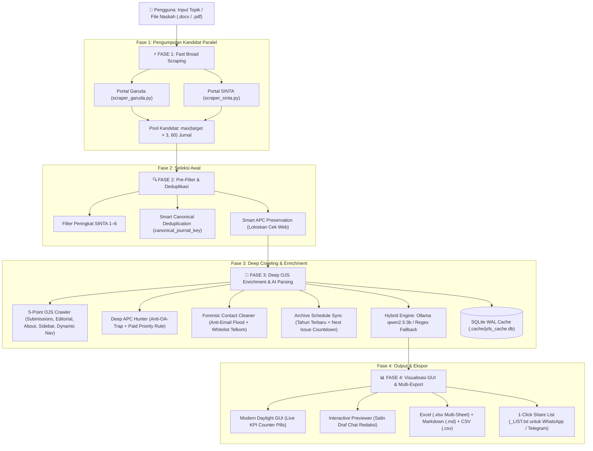

<div align="center">

  

  # 🎓 JSFS — Journal Scraper For Students
  ### *Hybrid AI Desktop Research Assistant for SINTA & Garuda Journals*

  <p align="center">
    <b>Otomatisasi Cerdas Pencarian Jurnal Ilmiah Terakreditasi SINTA 1–6 & Portal Garuda</b><br>
    <i>Ekstraksi Akurat Biaya Publikasi (APC), Jadwal Terbit, Kontak Redaksi, dan Generator 1-Klik Siap Share WhatsApp / Telegram.</i>
  </p>

  <p align="center">
    <a href="https://github.com/DavaAlgafiriSidiq/JSFS-Journal-Scraper-For-Students-/releases"></a>
    <a href="#"></a>
    <a href="#"></a>
    <a href="#"></a>
    <a href="#"></a>
    <a href="#"></a>
    <a href="LICENSE"></a>
  </p>

  <p align="center">
    <a href="#-kenapa-mahasiswa-membutuhkan-jsfs"><b>💡 Mengapa JSFS?</b></a> •
    <a href="#-fitur-unggulan-v170"><b>✨ Fitur Unggulan</b></a> •
    <a href="#-arsitektur--pipeline-4-fase"><b>🏗️ Arsitektur</b></a> •
    <a href="#-4-quick-presets-mahasiswa"><b>🎯 Quick Presets</b></a> •
    <a href="#-panduan-instalasi--penggunaan"><b>🚀 Cara Pakai</b></a> •
    <a href="#-format-output-ekspor"><b>📦 Format Output</b></a>
  </p>

</div>

---

## 💡 Kenapa Mahasiswa Membutuhkan JSFS?

Mencari jurnal target untuk publikasi skripsi, tesis, atau riset hibah di portal **SINTA** (*Kemdiktisaintek*) dan **Garuda** secara manual sering kali memakan waktu **berjam-jam bahkan berhari-hari**. Mahasiswa terpaksa membuka puluhan tab situs OJS (*Open Journal Systems*) satu per satu, hanya untuk menemukan informasi yang ambigu atau tersembunyi.

### ⚔️ Perbandingan: Manual Search vs. JSFS v1.7.0

| Parameter | ❌ Pencarian Manual (Web Browser) | ✅ Dengan JSFS v1.7.0 |
|---|---|---|
| **Waktu Pencarian** | 3–6 jam (membuka 30–50 tab satu per satu) | **< 60 detik** (otonom, konkuren & terfilter) |
| **Biaya Publikasi (APC)** | Sering terjebak tulisan *"Open Access"* pembaca atau biaya tersembunyi di OJS 2 | **Deep APC Hunter Engine** memindai 5 titik OJS + Anti-OA-Trap & Paid Priority |
| **Bulan Terbit** | Harus mengecek halaman arsip atau membaca teks narasi About | **Sync Otomatis Arsip** + Estimasi Countdown Terbit Terdekat |
| **Kontak Redaksi** | Email terproteksi Cloudflare atau tertukar email mahasiswa/penulis | **Forensic Data Purity**: Hard cap 3 email resmi kampus + Whitelist Kode Area Telkom/WA |
| **Kesesuaian Topik** | Membaca manual seluruh abstrak dan Focus & Scope | **Analisis Naskah (.docx/.pdf)** dengan skor kesesuaian cerdas 0–100% |
| **Berbagi ke Tim / Dosen** | Copy-paste manual teks yang berantakan | **1-Click WA Share**: Teks bernomor rapi siap dibagikan ke WhatsApp / Telegram |

---

## ✨ Fitur Unggulan (v1.7.0 Deep APC Hunter & Modern Bright GUI)

### 🎯 1. Deep APC Hunter Engine (Akurasi Biaya Setingkat Manusia)
- **Multi-Path OJS 2 & OJS 3 Crawler**: Memindai secara konsisten 5 titik wajib:
  1. `/about/submissions` (Halaman utama OJS 3)
  2. `/about/editorialPolicies` (Kritis untuk OJS 2 institusi lama seperti UII, PNB, dll.)
  3. `/about` (Halaman profil umum)
  4. Sidebar & Custom Blocks (`div.pkp_block`, `[id*="fee"]`, `[class*="customblock"]`)
  5. *Dynamic Menu Anchor Discovery* (Pindai tautan navbar yang memuat kata kunci tarif/biaya)
- **Anti-OA-Trap (Open Access Reader Policy Stripper)**: Menghapus kalimat retorika Open Access pembaca (*"freely available to the public"*, *"immediate open access"*) sebelum pencocokan kata kunci gratis untuk mengeliminasi 100% *false-positive* Gratis pada jurnal berbayar.
- **Paid Priority Rule**: Mendeteksi pola nominal bayar terlebih dahulu. Jika ditemukan nominal publikasi positif (mis. `Publication: 500,000.00 IDR`), status berbayar langsung menang mutlak meskipun pendaftaran berbiaya `Rp 0`.
- **Incomplete Cache Auto-Bypass & Auto-Purge**: Entri cache dengan status APC belum terdata otomatis di-bypass untuk deep scrape ulang, serta auto-purge database SQLite lama saat migrasi versi.

### ☀️ 2. Modern Bright GUI "Soft Slate Daylight"
- **Light Mode Default**: Tampilan visual ramah mata dengan palet slate daylight (`#f8fafc` / `#1e3a5f`) yang segar dan profesional.
- **Theme Switcher Instan (☀️ / 🌙)**: Berpindah antara Mode Terang dan Mode Gelap dalam 1 klik dengan adaptasi warna dinamis.
- **Live KPI Counter Pills**: Header metrik interaktif dengan 4 pil indikator (*Total Ditemukan*, *Gratis (Rp 0)*, *Berbayar*, *Terbit Dekat*) yang diperbarui secara thread-safe via antrean non-blocking.
- **1-Click WA Share Button**: Tombol aksi cepat *"📋 Salin Daftar (Share WA)"* di action bar utama untuk langsung menyalin daftar ringkas ke clipboard.

### 🛡️ 3. Forensic Data Purity & Anti-Noise
- **Anti-Email Flood (Maks 3 Email Resmi)**: Menolak otomatis seluruh email domain mahasiswa (`@student.`, `@mhs.`, `@mail.ugm.`, dll.) dan nomor NIM (>= 6 digit). Mengisolasi ekstraksi kontak dari daftar artikel agar email penulis tidak bocor ke redaksi.
- **Anti-Fake Phone & Whitelist Telkom (Maks 2 Telepon/WA)**: Memvalidasi nomor telepon kabel menggunakan whitelist 200+ kode area resmi Telkom Indonesia dan nomor seluler/WA (`+628...`). Menolak angka ID artikel/DOI yang menyerupai nomor telepon.
- **Focus & Scope 100% Bersih**: Menghapus derau tabel biodata OJS, metadata indeksasi (Scopus ID, Google Scholar), lisensi CC, dan menyintesis fokus keilmuan secara elegan dari rumpun SINTA/Garuda jika halaman web kosong.
- **Smart Canonical Deduplication**: Menyatukan jurnal duplikat atau migran (versi HTTP vs HTTPS) berdasarkan judul kanonikal bersih dan ISSN/E-ISSN resmi.

### ⚡ 4. High-Yield Recall & Zero-Crash Architecture
- **3× Candidate Pool Multiplier**: Mengambil kandidat awal sebanyak `max(target * 3, 60)` jurnal secara paralel, menjamin hasil pencarian topik populer (seperti bisnis, hukum, informatika) melimpah.
- **Smart APC Preservation**: Jurnal berstatus `"Cek Web / Belum Terdata"` tidak dibuang secara agresif; otomatis melengkapi kuota target saat pengguna memilih opsi gratis atau rentang biaya tertentu.
- **Safe Fetch HTTP Guard**: Membatasi ukuran baca maksimal 1.5 MB dan memvalidasi `Content-Type` HTML murni untuk mencegah aplikasi freeze akibat crawler mengunduh file PDF atau ZIP besar.
- **Zero-Crash Multi-Threading**: Koneksi pool HTTP berkecepatan tinggi (Turbo 64 workers / Normal 32 workers) dengan pelindung multi-layer `try...except` di seluruh thread.

---

## 🏗️ Arsitektur & Pipeline 4-Fase

JSFS bekerja menggunakan arsitektur pemrosesan bertingkat yang menjamin kecepatan dan kemurnian data:



---

## 🎯 4 Quick Presets Mahasiswa

Untuk kemudahan navigasi instan tanpa perlu mengatur belasan filter teknis, JSFS menyediakan **4 Preset Cepat**:

| Preset | Target Pengguna | Filter SINTA | Filter Biaya | Jadwal Terbit |
|---|---|:---:|:---:|:---:|
| 🎓 **Target Skripsi S1** *(Default)* | Mahasiswa S1 yang butuh syarat kelulusan realistis & terjangkau | **SINTA 3 – 5** | ≤ Rp 1.500.000 / Gratis | Semua Bulan |
| 💰 **Jurnal Gratis (Rp 0)** | Mahasiswa dengan anggaran terbatas yang mencari jurnal bebas biaya publikasi | **SINTA 2 – 6** | **Hanya Gratis (Bebas APC)** | Semua Bulan |
| ⚡ **Terbit Terdekat** | Mahasiswa yang mengejar tenggat waktu sidang/yudisium dalam hitungan minggu | **SINTA 3 – 6** | Bebas | **1–3 Bulan ke Depan** |
| 🏆 **Reputasi Tinggi** | Mahasiswa Magister (S2), Doktoral (S3), atau penerima hibah riset | **SINTA 1 – 2** *(Scopus)* | Bebas | Semua Bulan |

---

## 🚀 Panduan Instalasi & Penggunaan

### Opsi A: Menggunakan Executable Mandiri (Paling Mudah, Tanpa Python)
1. Unduh berkas **`JSFS.exe`** versi terbaru dari folder `dist/` atau [Halaman Releases](../../releases).
2. Letakkan di folder pilihan Anda (misalnya `D:\JSFS\`).
3. Klik dua kali pada **`JSFS.exe`** untuk langsung menjalankan aplikasi!
   > *Catatan: Tidak memerlukan instalasi Python, Git, atau library eksternal apapun.*

---

### Opsi B: Menjalankan dari Source Code (Python)

#### 1. Prasyarat Sistem
- **Sistem Operasi**: Windows 10 / 11 (64-bit).
- **Python**: Versi 3.10 atau lebih baru (Python 3.12+ didukung penuh).

#### 2. Kloning Repositori & Persiapan Lingkungan
```bash
# 1. Kloning repositori
git clone https://github.com/DavaAlgafiriSidiq/JSFS-Journal-Scraper-For-Students-.git
cd JSFS-Journal-Scraper-For-Students-

# 2. Buat dan aktifkan virtual environment
python -m venv venv
venv\Scripts\activate

# 3. Instal dependensi resmi
pip install -r requirements.txt
```

#### 3. Menjalankan Aplikasi GUI Desktop
```bash
python app_ui.py
```

#### 4. Menjalankan via Terminal / CLI
```bash
# Mode CLI Interaktif (Wizard Tanya-Jawab)
python jsfs.py --interactive

# Perintah Langsung dengan Filter
python jsfs.py --keyword "sistem informasi" --sinta 3 4 --format md excel csv

# Pencarian dengan Naskah Skripsi
python jsfs.py --keyword "akuntansi publik" --file "D:/skripsi_bab1.docx" --turbo
```

---

## 📦 Format Output Ekspor

Seluruh berkas hasil pencarian tersimpan otomatis di dalam folder **`output/`** dengan timestamp rapi:  
`JSFS_<keyword>_<YYYYMMDD_HHMMSS>.<ext>`

```
output/
├── JSFS_bisnis_20261109_200000.xlsx       # Workbook Excel multi-sheet profesional
├── JSFS_bisnis_20261109_200000.md         # Laporan Markdown lengkap dengan direktori kontak
├── JSFS_bisnis_20261109_200000.csv        # Tabel flat CSV UTF-8 BOM
└── JSFS_bisnis_20261109_200000_LIST.txt   # Daftar ringkas 1-klik siap salin ke WhatsApp
```

<details>
<summary><b>📋 Contoh Output Berkas Ringkas (Format Share WhatsApp)</b></summary>

```text
1. Jurnal Manajemen dan Bisnis (Sinta 3 - Universitas Muhammadiyah Surakarta)
Email: benefit@ums.ac.id, redaksi.benefit@ums.ac.id
Telepon/WA: +6281234567890
Biaya Publikasi: Rp 500.000 | Terbit: Juni, Desember
Fokus: Riset ilmiah di bidang Manajemen Strategis, Bisnis Syariah, Pemasaran, dan Kewirausahaan.
Link OJS: https://journals.ums.ac.id/index.php/benefit

2. Jurnal Akuntansi dan Keuangan Indonesia (Sinta 2 - Universitas Indonesia)
Email: jaki@ui.ac.id
Telepon/WA: (021) 7272425
Biaya Publikasi: Gratis (Rp 0) | Terbit: Juni, Desember
Fokus: Pengembangan ilmu akuntansi keuangan, audit, perpajakan, dan pasar modal.
Link OJS: https://scholarhub.ui.ac.id/jaki
```
</details>

---

## 🛠️ Tech Stack & Dependensi Resmi

JSFS dirancang dengan prinsip **keringanan maksimal** (*zero heavy ML bloatware*) agar ukuran biner tetap di bawah ~280 MB tanpa mengorbankan kecerdasan ekstraksi:

| Komponen | Pustaka / Teknologi | Versi | Peran Utama |
|---|---|:---:|---|
| **GUI Framework** | `customtkinter` | `5.2.2` | Antarmuka modern Soft Slate Daylight / Dark Mode adaptif |
| **HTTP Engine** | `requests` + `urllib3` | `2.32.3` | Connection pool berkapasitas tinggi & anti-freeze fetcher |
| **HTML Parser** | `beautifulsoup4` + `lxml` | `4.12.3` | Parsing dokumen HTML OJS dengan toleransi tag rusak |
| **Headless Driver** | `undetected-chromedriver` | `3.5.5` | Bypass proteksi Cloudflare SINTA bila diperlukan |
| **Local Cache** | `sqlite3` *(Built-in)* | `WAL Mode` | Caching metadata OJS lokal 14 hari via path `.cache/` |
| **Data Processing** | `pandas` + `openpyxl` | `2.2.3` | Pembuatan file Excel multi-sheet dan tabel CSV |
| **Document Reader** | `python-docx` + `pypdf` | `1.2.0` | Ekstraksi teks naskah skripsi untuk kalkulasi relevansi |
| **Terminal Display**| `rich` | `13.9.4` | Tampilan tabel dan progress bar interaktif di mode CLI |
| **Compiler Binary** | `PyInstaller` | `6.11.0` | Pembuatan biner portabel mandiri `JSFS.exe` |

---

## 🏗️ Cara Build Binary Mandiri (`JSFS.exe`)

Jika Anda memodifikasi kode sumber dan ingin mengompilasi ulang file `.exe`:

```bash
python -m PyInstaller --noconfirm --clean JSFS.spec
```

Berkas biner hasil kompilasi akan otomatis dibuat di:
`dist/JSFS.exe` *(Ukuran: ~275 MB, siap digunakan di PC manapun tanpa instal Python)*.

---

## 🗺️ Roadmap Pengembangan

- [x] **v1.0.0 – v1.3.8**: Core crawler Garuda & SINTA, CLI, dan GUI CustomTkinter awal.
- [x] **v1.4.0**: Integrasi Hybrid AI Engine (Ollama `qwen2.5:3b` + Smart Regex Fallback).
- [x] **v1.5.0 – v1.5.1**: Smart SQLite WAL Cache, Top 3 AI Advisor, dan 4 Quick Presets Mahasiswa.
- [x] **v1.6.0**: Dynamic Menu Anchor Discovery, Cloudflare Decoder, dan 1-Click Copy-Paste List.
- [x] **v1.6.1 – v1.6.2**: Forensic Data Purity, Anti-Email Flood, Telkom Area Code Whitelist, dan Smart Canonical Deduplication.
- [x] **v1.7.0 (Versi Saat Ini)**: Deep APC Hunter Engine (Anti-OA-Trap, Paid Priority, 5-Point OJS Crawler), Modern Bright GUI (Soft Slate Daylight), Live KPI Counter Pills, dan 1-Click WA Share Button.
- [ ] **v2.0.0 (Mendatang)**: Platform Web App Multi-User (FastAPI + React / Tailwind CSS) untuk instalasi bersama di server laboratorium kampus.

---

## 🔒 Privasi & Keamanan (Zero Cloud Dependency)

- **100% Berjalan Lokal**: Seluruh proses scraping, analisis naskah, pencarian, dan database cache berjalan sepenuhnya di komputer lokal Anda.
- **Tanpa Pengiriman Data ke Cloud**: Naskah skripsi/tesis Anda tidak pernah diunggah ke server pihak ketiga manapun.
- **Etika Scraping**: Menggunakan jeda waktu acak (*polite rate limiting*) dan identitas User-Agent yang transparan untuk menjaga kehandalan server kampus yang dikunjungi.

---

## 📄 Lisensi & Kontribusi

Proyek ini dilisensikan di bawah lisensi **MIT License** — silakan gunakan, pelajari, dan kembangkan untuk mendukung kemajuan riset ilmiah mahasiswa Indonesia.

Kontribusi, pelaporan bug, dan saran fitur sangat diterima melalui [GitHub Issues](../../issues) atau Pull Requests.

---

<div align="center">

*Dikembangkan dengan ❤️ untuk Seluruh Mahasiswa & Peneliti Pejuang Publikasi Ilmiah Indonesia.*<br>
<sub><b>Disclaimer:</b> Selalu periksa kembali keaslian jurnal dan pedoman penulisan (*Author Guidelines*) pada situs resmi OJS masing-masing penerbit sebelum mengirimkan naskah akhir.</sub>

</div>
